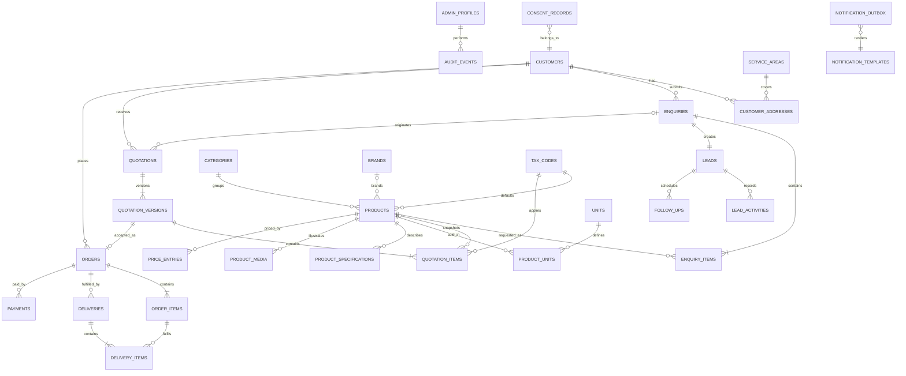

# Database Design and ERD

**Version:** 0.2  
**Status:** MVP operational schema implemented; advanced accounting remains deferred  
**Last updated:** 28 October 2026

## 0. Implemented MVP schema

The Prisma schema and applied migrations currently provide:

- `admin_profiles` linked to Supabase Auth users;
- `products` with publication and availability controls, without public pricing;
- `customers` deduplicated by normalized phone number;
- `enquiries` linked to customers with status, source and follow-up date;
- `enquiry_items` linked to products;
- `enquiry_activities` for creation, notes, status changes and follow-up changes;
- versioned `quotations` and item snapshots with configurable tax treatment;
- accepted-quotation `orders`, `deliveries` and manual `payments`;
- `notification_outbox` and privacy-safe `enquiry_submission_attempts`;
- append-oriented `audit_events` for important business mutations.

The detailed logical model below also records future refinements such as separate order-line
delivery allocation and customer address books; those refinements are not required for the
current MVP workflow.

## 1. Design principles

- UUID primary keys are internal; readable references are separate unique columns.
- Referenced records are archived rather than physically deleted.
- Historical commercial documents contain snapshots.
- Status fields use constrained enums or lookup tables plus explicit transition services.
- All mutable tables include `created_at`, `updated_at`, and where relevant `created_by` and `updated_by`.
- Personal data is kept only where operationally necessary.

## 2. Core ERD

## 3. Identity and administration

### `admin_profiles`

Extends `auth.users` without copying credentials.

| Column         | Type        | Notes                        |
| -------------- | ----------- | ---------------------------- |
| `id`           | uuid        | PK and FK to `auth.users.id` |
| `display_name` | text        | Required                     |
| `role`         | role enum   | `owner` in MVP               |
| `is_active`    | boolean     | Required, default true       |
| `last_seen_at` | timestamptz | Optional                     |

Future roles: `manager`, `sales`, `operations`, and `accounts`. The MVP UI exposes only the owner profile.

## 4. Catalogue

### `categories`

Name, slug, summary, SEO fields, display order, published flag, archived timestamp.

### `brands`

Name, slug, optional description, published flag, archived timestamp. A brand must not be invented merely to fill a catalogue field.

### `products`

Category, optional brand, name, slug, product type, public description, internal notes, default tax code, availability status, published flag, display order, SEO fields, and archived timestamp. It intentionally has no public-price field.

### `units`

Canonical code, display name, symbol, quantity precision, and active flag. Likely examples such as bag, tonne, kilogram, cubic foot, load, piece, litre, and square foot require owner confirmation before seeding.

### `product_units`

Product-to-unit mapping with default-quote flag and optional minimum quantity.

### `product_specifications`

Product, specification key, display label, value, unit label, display order, and public flag. This supports cement type and bag weight, steel grade and diameter, and brick dimensions without a different table per category.

### `product_media`

Product, storage key or approved URL, media kind, alt text, display order, and primary flag.

### `price_entries`

Private internal price history: product, unit, amount, currency, effective date/time, end date/time, availability, source note, and creator. Public roles have no access.

### `tax_codes`

Code, label, CGST rate, SGST rate, IGST rate, cess rate, inclusive/exclusive behavior, effective dates, and active flag. Issued quotation items copy applicable rates.

## 5. Customers and consent

### `customers`

Reference number, display name, normalized phone, raw display phone, optional normalized email, type, GSTIN when legitimately collected, organization name, notes, and archived timestamp.

A normalized phone is the primary duplicate-detection signal, not an absolute guarantee that two requests belong to one person. Suspected matches can be reviewed and merged later.

### `customer_addresses`

Customer, label, address lines, locality, taluk, district, state, PIN code, landmark, optional coordinates, optional matched service area, and default flag.

### `consent_records`

Customer or enquiry, consent type, granted/withdrawn state, notice version, collection channel, timestamp, and evidence metadata. Marketing consent is separate from permission to respond to an enquiry.

## 6. Enquiries and CRM

### `enquiries`

Human reference, customer, delivery-address snapshot, preferred delivery date, instructions, source, campaign fields, submission channel, consent-notice version, idempotency-key hash, status, and timestamps.

### `enquiry_items`

Enquiry, optional product, customer-entered description snapshot, quantity, unit, and item notes. A free-text snapshot protects the original request if the catalogue later changes.

### `leads`

Enquiry, customer, stage, priority, assigned profile, next-follow-up time, qualified time, won/lost time, loss reason, and timestamps.

### `lead_activities`

Lead, activity type, actor, body, metadata, occurred time, and optional related entity. Activities form a readable timeline; they are not a security audit substitute.

### `follow_ups`

Lead, assigned profile, due time, purpose, status, completed time, completion note, and reminder-delivery state.

## 7. Quotations

### `quotations`

Quotation reference, customer, optional enquiry and lead, current-version number, lifecycle status, accepted-version ID, and timestamps.

### `quotation_versions`

Quotation, version number, state (`draft`, `issued`, `expired`, `accepted`, `rejected`, `superseded`), customer and address snapshots, issue and validity dates, currency, subtotal, discounts, transport, other charges, taxable amount, tax totals, round-off, grand total, terms snapshots, calculation-policy version, acceptance metadata, PDF storage key, issuer, and timestamps.

Unique constraint: `(quotation_id, version_number)`.

### `quotation_items`

Version, optional product, description/specification snapshots, quantity, unit snapshot, unit rate, discount type/value, taxable value, tax-code snapshot, tax rates/amounts, and line total.

## 8. Orders and delivery

### `orders`

Order reference, customer, accepted quotation version, status, ordered date, customer/address/commercial snapshots, totals, cancellation metadata, and timestamps. One quotation version creates at most one active order unless an explicitly audited override is introduced later.

### `order_items`

Order, originating quotation item, item snapshots, ordered quantity, unit, rate and total snapshots, delivered quantity cache, and completion state.

### `deliveries`

Delivery reference, order, scheduled and actual timestamps, status, address snapshot, vehicle number, driver name, driver phone, notes, proof storage key, receiver name, and creator.

### `delivery_items`

Delivery, order item, planned quantity, delivered quantity, rejected/returned quantity if later needed, unit snapshot, and notes.

## 9. Payments

### `payments`

Payment reference, order, amount, currency, received date/time, method, external reference, status (`recorded`, `reversed`), note, recorder, reversal reason, reversing actor, and timestamps.

Order balance is calculated from the immutable order total minus non-reversed payments. A cached balance may be maintained only with a tested reconciliation query.

## 10. Notifications and audit

### `notification_templates`

Purpose, channel, locale, version, subject/body template, active flag, and timestamps.

### `notification_outbox`

Channel, recipient destination in protected form, template/version, payload, related entity, idempotency key, state, attempt count, next attempt, provider ID, last error redacted, and timestamps.

### `audit_events`

| Column                      | Purpose                                    |
| --------------------------- | ------------------------------------------ |
| `id`                        | UUID event identifier                      |
| `occurred_at`               | Immutable UTC timestamp                    |
| `actor_type`                | Admin, system, public, provider            |
| `actor_id`                  | Nullable authenticated profile             |
| `action`                    | Stable event code                          |
| `entity_type` / `entity_id` | Affected record                            |
| `before_data`               | Redacted JSON snapshot or changed fields   |
| `after_data`                | Redacted JSON snapshot or changed fields   |
| `reason`                    | Required for sensitive overrides/reversals |
| `request_id`                | Correlation identifier                     |
| `metadata`                  | Safe contextual JSON                       |

Database permissions deny update and delete through application roles. Highly sensitive values, secrets, full notification bodies, and unnecessary personal data are excluded.

## 11. Reference numbering

Human references use a database-controlled sequence and year, for example:

- `ENQ-2026-000001`
- `QUO-2026-000001`
- `ORD-2026-000001`
- `DLV-2026-000001`
- `PAY-2026-000001`

These identifiers are for communication, not authorization. Public confirmation lookup requires an additional unguessable token or authenticated context.

## 12. Essential database constraints

- All quantities must be greater than zero.
- Monetary amounts cannot be negative except an explicitly modelled adjustment.
- Validity end cannot precede issue date.
- Preferred and scheduled dates use business validation while allowing legitimate urgent requests.
- Exactly one primary product image and one default product unit at most.
- Enquiry idempotency key hash is unique within its retention window.
- Issued quotation versions reject updates through database policy/trigger.
- Accepted version belongs to the same quotation.
- Order accepted version is accepted and belongs to the same customer.
- Payment currency matches order currency in the MVP.
- Delivery item belongs to the delivery's order.
- Audit events reject ordinary update and delete operations.

## 13. Index plan

- Unique indexes on slugs and human references.
- B-tree indexes on statuses plus relevant dates for work queues.
- Composite lead index on `(stage, next_follow_up_at)`.
- Composite order index on `(status, created_at desc)`.
- Composite notification index on `(state, next_attempt_at)`.
- Normalized customer phone and email indexes.
- Trigram or full-text indexes only after search behavior is defined and measured.
- Audit index on `(entity_type, entity_id, occurred_at desc)`.

Indexes will be validated with representative queries rather than added speculatively.

## 14. Retention and deletion

Retention periods require legal and business approval. The design supports archiving catalogue/customer records, anonymizing customer data where legally permitted, and retaining commercial/audit records where required. Customer deletion must not corrupt historical quotations, orders, tax records, or audit evidence.
