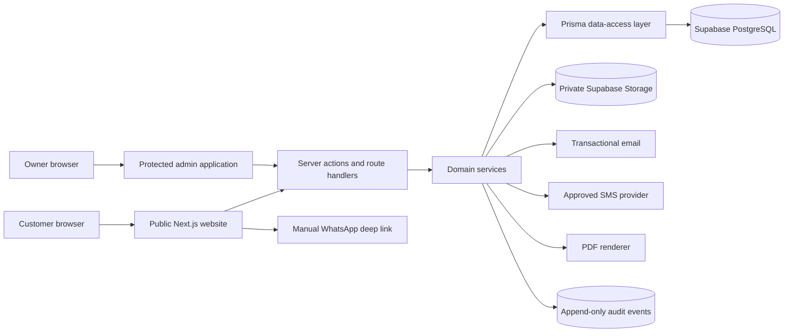

# Technical Architecture

**Version:** 0.2  
**Status:** Foundation implemented  
**Last updated:** 25 October 2026

## 1. Architecture decision

RVKumar Traders will use a modular monolith built with Next.js. The public website and protected administration application will share one repository and deployment while retaining strict module and authorization boundaries.

This gives the MVP one deployable system, one data model, and one audit trail without the cost and operational burden of microservices. Domain services are kept independent enough to extract later only if actual scale requires it.

## 2. System context



## 3. Proposed repository layout

```text
src/
|-- app/
|   |-- page.tsx
|   |-- products/
|   |-- enquiry/
|   |-- contact/
|   |-- admin/
|   |   |-- login/
|   |   `-- (protected)/
|   |-- api/
|   |   |-- enquiries/
|   |   `-- products/
|   |-- sitemap.ts
|   `-- robots.ts
|-- components/
|   |-- admin/
|   |-- forms/
|   `-- products/
|-- services/
|   |-- enquiry.service.ts
|   `-- product.service.ts
|-- validators/
|-- types/
|-- lib/
|   |-- prisma.ts
|   |-- auth/
|   |-- supabase/
|   |-- notifications/
|   |-- rate-limit/
|   `-- env.ts
`-- proxy.ts
prisma/
|-- schema.prisma
`-- migrations/
supabase/
|-- migrations/
|-- seed.sql
`-- tests/
docs/
tests/
|-- unit/
|-- integration/
`-- e2e/
```

Route Handlers own HTTP concerns, validators own input contracts, services own business rules, and Prisma owns PostgreSQL queries. Cross-feature mutations go through an application service rather than importing database operations directly into pages.

Supabase remains responsible for Auth, session cookies, Storage, local infrastructure, RLS and database grants. Prisma is responsible for typed business-data access and future business-schema migrations. Prisma must not manage Supabase's internal `auth` or `storage` schemas.

Prisma Client is generated into `node_modules/@prisma/client`, keeping generated internals out of the authored `src/` tree. Generated files are never edited manually.

## 4. Request boundaries

### Public reads

Public pages may read only published products, published categories, verified service areas, approved FAQs, and public business settings. Public database views should omit all internal prices, costs, notes, contact recipients, and unpublished content.

### Public writes

Quotation enquiries are accepted through a dedicated server endpoint. The endpoint performs origin checks, rate limiting, bot protection, schema validation, normalization, idempotency checks, transaction creation, and asynchronous notification dispatch.

### Protected reads and writes

Admin routes require a valid session. Every query and mutation checks permission server-side. Row Level Security provides a second boundary. Client components never receive service-role credentials or unrestricted database clients.

## 5. Domain modules

| Module        | Owns                                                                   | Does not own                            |
| ------------- | ---------------------------------------------------------------------- | --------------------------------------- |
| Catalogue     | Categories, products, specifications, units, publication, availability | Quoted historical rates                 |
| Enquiries     | Public request intake and enquiry lines                                | Lead follow-up or quotations            |
| Leads         | Pipeline state, assignment, notes, follow-ups, activity                | Customer master data                    |
| Customers     | Identity, customer type, contacts, addresses                           | Enquiry state                           |
| Quotations    | Drafting, calculation, versions, issue, expiry, acceptance             | Order fulfilment                        |
| Orders        | Accepted commercial commitment and order state                         | Delivery execution or receipts          |
| Deliveries    | Delivery schedule, lines, dispatch, proof                              | Order pricing                           |
| Payments      | Manual receipts, reversal, allocation, balance                         | Accounting ledger or gateway settlement |
| Notifications | Provider-neutral message queue and delivery results                    | Business state changes                  |
| Audit         | Immutable record of important mutations                                | Operational notes                       |
| Reports       | Read-only aggregates and work queues                                   | Source-of-truth mutations               |

## 6. Data consistency rules

- Business mutations affecting multiple records use a database transaction.
- Money uses `numeric(14,2)` and quantities use `numeric(14,3)` unless a unit demands greater precision.
- Currency is stored explicitly and defaults to `INR` through configuration.
- Timestamps are stored as UTC `timestamptz`; the UI renders Asia/Kolkata.
- Issued quotation versions are immutable.
- An order stores a snapshot of accepted quotation commercial terms.
- Delivery quantities cannot exceed the remaining deliverable quantity without an explicit override and audit reason.
- Reversed payments remain stored and are excluded from received totals.
- Soft deletion is used for referenced business records; audit records are never soft-deleted through the app.
- Status changes use explicit transition functions, not arbitrary column updates.

## 7. Enquiry submission reliability

1. Browser creates an idempotency key.
2. Server validates request size, schema, consent, phone, PIN, quantities, and permitted units.
3. Rate limiter checks IP-derived and normalized-phone buckets without retaining raw IP longer than required.
4. One transaction upserts a customer candidate, creates the enquiry and lines, creates the lead, records consent, and appends audit/activity events.
5. The transaction commits before external notifications begin.
6. Notification jobs are inserted into an outbox table in the same transaction.
7. A worker or scheduled handler sends pending notifications and records provider outcomes.
8. Retrying the same idempotency key returns the original success response.

This outbox pattern prevents a provider failure from losing an enquiry.

## 8. Quotation calculation boundary

The server-side quotation calculator is a pure, versioned function. Inputs include line quantity, unit rate, discount, tax treatment, transport, other charges, rounding policy, and currency. Outputs include line taxable value, tax breakdown, subtotal, adjustments, round-off, and grand total.

Client calculations are previews only. The server recalculates and persists authoritative values. Calculation-policy version is stored with every issued quotation version to keep old documents reproducible.

## 9. Authentication and sessions

- Supabase email/password or passwordless email is used for the owner account; the final method is selected during foundation setup.
- Multi-factor authentication should be enabled for the owner before production launch.
- Admin access requires both an authenticated user and an active application profile.
- Session cookies use secure, HTTP-only, same-site settings supported by the Supabase Next.js integration.
- Login, logout, failed access, profile changes, and recovery events are audited where available.
- There is no public customer login in the MVP.

## 10. Files and documents

- Product images may use a public, optimized media bucket after approval.
- Proofs of delivery, acceptance documents, and quotation artifacts use private buckets.
- File paths use generated identifiers, not customer names or phone numbers.
- Uploads are restricted by MIME type, extension, byte size, and ownership.
- Private downloads use short-lived signed URLs after authorization.
- PDF files may be regenerated from immutable quotation-version data; stored copies can be retained when a legally stable issued artifact is required.

## 11. Notifications

Notification delivery uses adapters:

```text
NotificationService
|-- EmailAdapter
|-- SmsAdapter
`-- WhatsAppLinkBuilder (manual MVP)
```

Templates are versioned. Messages contain minimal customer information. Provider callbacks are authenticated before updating delivery status. Failed notifications use bounded retries and then appear in an admin failure queue.

## 12. SEO rendering architecture

- Product/category/service-area pages use server rendering or static generation with controlled revalidation.
- Metadata is generated from approved public content only.
- Published-content changes invalidate relevant page caches.
- JSON-LD is produced by typed serializers and escaped before output.
- Sitemap includes canonical, indexable public routes only.
- Confirmation, admin, internal search, and parameter variants are not indexable.
- Images use responsive sizing and descriptive alt text supplied through content fields.

## 13. Observability

- Structured server logs with request/correlation IDs.
- Error monitoring with personal data redaction.
- Provider request IDs stored for notification troubleshooting.
- Health checks for application and database reachability.
- Metrics for enquiry success/failure, notification failure, PDF failure, authentication failures, and slow requests.
- Audit history is not a substitute for operational logs, and logs are not a substitute for audit history.

## 14. Backup and recovery

- Enable Supabase-supported database backups appropriate to the selected plan.
- Export schema migrations and keep them version-controlled.
- Define Recovery Point Objective and Recovery Time Objective before launch.
- Periodically test restoration into a non-production project.
- Retain critical private documents according to the approved retention policy.
- Record backup and restoration tests in an operational runbook.

## 15. Environments and secrets

Use separate local, preview/staging, and production configurations. Database projects should be separate for production and non-production where budget allows.

Secrets are validated on server startup and never prefixed with `NEXT_PUBLIC_`. Browser-safe public configuration is explicitly allowlisted. `.env.example` contains names and documentation only, never real values.

## 16. Testing layers

| Layer           | Focus                                                          |
| --------------- | -------------------------------------------------------------- |
| Unit            | Money, GST, identifiers, validators, transition rules          |
| Database        | Constraints, RLS policies, transactional functions             |
| Integration     | Services with database, storage, and mocked providers          |
| Component       | Forms, tables, status controls, validation feedback            |
| End-to-end      | Enquiry, lead, quotation, order, delivery, payment journeys    |
| Security        | Unauthorized access, IDOR, rate limit, upload validation       |
| Accessibility   | Keyboard, focus, semantics, contrast, mobile reflow            |
| SEO/performance | Metadata, canonical, JSON-LD, sitemap, Core Web Vitals budgets |

## 17. Architecture decisions to confirm during implementation

- Owner sign-in method and MFA enrollment flow.
- Transactional email provider.
- Approved Indian SMS provider and DLT requirements.
- PDF renderer after deployment-runtime verification.
- Background job mechanism compatible with the selected Vercel/Supabase plan.
- Analytics provider and consent model.
- Backup plan and retention periods.
